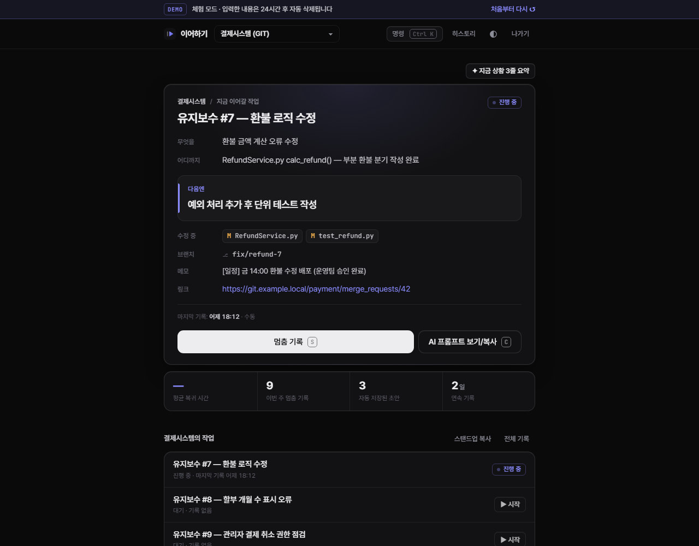

# 이어하기 — 어제 멈춘 곳에서, 1분 안에 다시 시작

> 멈출 때 한 줄, 돌아올 때 카드 한 장.
> 회의·상급자 호출로 하루에도 몇 번씩 끊기는 개발자를 위한 "중단 지점 기록" 도구.

**▶ 바로 체험 (로그인 없음): https://ieohagi.vercel.app/#/demo**
사이트: https://ieohagi.vercel.app



---

## 왜 만들었나

신규 개발과 유지보수를 함께 맡은 개발자는 출근할 때마다 메모장·메일·캘린더·커밋 로그를 뒤지며 **"어제 어디까지 했지?"** 를 복구하는 데 30분~1시간을 씁니다. 갑작스러운 회의나 호출로 자리를 뜨면 같은 일이 하루에도 몇 번씩 반복됩니다.

원인은 할 일 목록이 없어서가 아니라 **멈출 때 아무것도 기록하지 않아 "중단 지점의 맥락"이 사라지는 것**입니다. 그래서 이 도구는 기록 부담을 최소화하는 데 모든 것을 맞췄습니다.

| 목표 | 구현 |
|---|---|
| 출근 후 **1분 안에** 작업 시작 | 첫 화면은 목록이 아니라 **이어하기 카드 한 장**. 복귀 시간을 실제로 재서 보여줌 |
| 급히 떠날 때 **10초 안에** 기록 | `S` → "다음엔" 한 줄 → `Enter`. 시간이 없으면 [그냥 저장] |
| 버튼을 깜빡해도 맥락 보존 | 5분마다 + 탭 전환·창 닫기 때 **자동 저장** (변경 있을 때만) |

## 핵심 기능

| | 기능 | 설명 |
|---|---|---|
| F1 | **이어하기 카드** | 무엇을 · 어디까지 · **다음엔** + 수정 중 파일·브랜치·메모. 자동 초안이 더 새로우면 수동 기록의 "다음엔"과 합쳐서 표시 |
| F2 | **10초 멈춤 기록** | 열리자마자 "다음엔"에 커서, `Enter`로 저장. 무엇을/어디까지는 직전 값으로 미리 채움 |
| F3 | **작업 히스토리** | 프로젝트 → 작업 → 기록 타임라인. 수동 기록은 크게, 자동 기록은 한 줄로 접힘 |
| ✦ | **git/svn status 해석** | `git status`(영어·한국어 로케일), `--short`, `svn status`를 붙여넣으면 자동 감지 → 파일·브랜치 추출 |
| ✦ | **AI 프롬프트 · CONTEXT.md** | opencode·Claude 등에 바로 붙여넣는 프롬프트, 프로젝트 폴더에 두는 `.resume/CONTEXT.md` 내려받기 |
| ✦ | **Gemini 3줄 복귀 브리핑** | 최근 기록 10건 → "하던 일 / 멈춘 지점 / 다음 할 일". 버튼을 눌렀을 때만 호출, 기록이 그대로면 캐시 |
| ✦ | **오늘의 스탠드업** | 멈춤 기록으로 "지난 작업 / 오늘 할 일"을 AI 없이 생성 → 데일리 스크럼에 붙여넣기 |
| ✦ | **복귀 시간 · 주간 통계** | 화면을 연 순간부터 첫 행동까지 걸린 시간을 측정해 평균 표시 (목표 60초), 연속 기록 일수 |
| ✦ | **명령 팔레트** | `Ctrl/⌘ K` — 멈춤 기록, 프롬프트 복사, 작업 시작, 프로젝트 전환을 키보드로 |
| ✦ | **체험 모드** | 방문자별 임시 계정 + 샘플 데이터(결제시스템 Git·인사관리 SVN·"다음엔 없는 날"), 24시간 후 자동 삭제 |

설치형 웹앱(PWA)으로 휴대폰 홈 화면에 추가할 수 있고, 모바일 레이아웃을 지원합니다.
디자인은 **단일 다크 테마**로 통일했습니다 — OS·브라우저 설정과 관계없이 누가 어디서 열어도 같은 화면이 보이고, 앱 아이콘·미리보기 이미지와도 같은 톤입니다.

## 설계 원칙

1. **목록에서 고르게 하지 않는다** — 시작 화면은 "지금 이어갈 작업 하나"만 크게.
2. **쓰는 양을 최소화한다** — 사람만 아는 정보("다음엔")만 쓰게 하고 나머지는 미리 채운다.
3. **AI 도구에 종속되지 않는다** — AI 없이도 카드·프롬프트 텍스트만으로 이어갈 수 있다. AI(Gemini)는 선택 기능.
4. **PC에 아무것도 설치하지 않는다** — 웹만으로 동작. VCS 상태는 붙여넣기로 해석.

## 구조

```
브라우저 (빌드 없는 SPA: public/)
  │  fetch · sendBeacon(자동 저장)
  ▼
Vercel Python 서버리스 (FastAPI, 서울 리전 icn1)
  ├─ backend/main.py      라우트 · 인증 · 사용자별 데이터 격리
  ├─ backend/services.py  카드 병합 규칙 · 주간 통계 · 스탠드업
  ├─ backend/vcs.py       git/svn status 파서
  ├─ backend/briefing.py  Gemini 호출 (모델 폴백 · 캐시)
  └─ backend/seed.py      체험 모드 샘플
  │  SQLAlchemy (NullPool)
  ▼
Supabase PostgreSQL (서울)          ← 로컬 개발은 SQLite, 같은 코드
```

데이터 모델: `User 1─N Project 1─N Task 1─N Record`, `Task 1─1 Briefing`

## 보안·안정성

- 이름 + 4자리 PIN(PBKDF2 해시). **5회 실패 시 5분 잠금** — 시도 횟수를 PIN 검사 전에 원자적으로 올려 동시 요청으로도 우회 불가
- HttpOnly · Secure · SameSite=Lax 서명 쿠키 30일. 모든 조회에 `user_id` 조건
- Supabase 테이블 RLS 활성화(REST API 노출 차단). 앱은 서버에서만 DB 접속
- Gemini 키는 서버 환경 변수로만 관리, 사용자별 하루 30회 제한, 무료 등급 데이터 정책 안내 후 전송
- 체험 계정 IP당 시간당 20회·전체 300회, 가입 IP당 시간당 10회 제한
- 사용자 입력은 모두 이스케이프 후 렌더링, 링크는 http(s)만 허용

## 완료 기준 (PRD DoD) 점검

| 항목 | 상태 |
|---|---|
| 이름+PIN 로그인, 5회 실패 잠금 | ✅ 동시 요청 포함 테스트 |
| 프로젝트·작업 추가, [▶ 시작]으로 활성 작업 지정 | ✅ |
| "다음엔"만 쓰고 저장, 직전 값 미리 채움 | ✅ |
| 버튼 → 한 줄 → Enter, 10초 안에 저장 | ✅ |
| Gemini 요약, 기록 그대로면 재호출 안 함, 키 없으면 버튼 숨김 | ✅ 배포본에서 확인 |
| 체험 모드 브리핑은 미리 만든 요약, API 호출 없음 | ✅ |
| 5분·창 닫을 때 자동 저장, 변경 없으면 저장 안 함 | ✅ |
| git/svn status → 파일·브랜치 추출 | ✅ |
| 카드 스크롤 없이 표시, 프롬프트 복사 | ✅ |
| "다음엔" 비면 안내 + 입력칸 | ✅ |
| 히스토리 시간순, 자동 기록 접힘 | ✅ |
| 휴대폰에서 로그인·카드 확인 | ✅ 375px 가로 넘침 없음 |
| Vercel 배포, 재배포 후 데이터 유지 | ✅ Supabase |
| [샘플로 체험하기] 3초 안에 #7 카드 | ✅ 약 1초 |
| 체험 데이터 분리·24시간 후 삭제 | ✅ Vercel Cron + 요청 시 정리 |

## 로컬 실행 (Windows)

```bash
python -m venv .venv
.venv/Scripts/python -m pip install -r requirements.txt uvicorn httpx
.venv/Scripts/python -m uvicorn index:app --reload --port 8000
```

http://localhost:8000 — DB는 `./resume.db`(SQLite)에 자동 생성됩니다.
환경 변수는 `.env.example`을 `.env`로 복사해 채웁니다 (예: `GEMINI_API_KEY=...`). `.env`는 git·배포에서 제외되며, 이미 설정된 환경 변수가 우선합니다.

테스트 (파서·API·잠금 경쟁 조건·체험 모드 등 11개):

```bash
.venv/Scripts/python tests/test_api.py
```

## 배포 (Vercel + Supabase)

1. Vercel에서 이 저장소를 import (FastAPI 자동 감지)
2. Storage → Supabase 연동으로 DB 생성 (접속 주소 `POSTGRES_URL`이 자동으로 들어감)
3. 환경 변수: `GEMINI_API_KEY`(선택), `SECRET_KEY`(권장), `GEMINI_MODEL`(기본 `gemini-3.5-flash`), `CRON_SECRET`(선택)
4. 환경 변수를 바꾼 뒤에는 재배포해야 반영됩니다

| 경로 | 내용 |
|---|---|
| `index.py` | Vercel 진입점 |
| `backend/` | FastAPI 서버 |
| `public/` | 프론트엔드 (`index.html`, `app.js`, `style.css`, PWA 매니페스트·아이콘·미리보기 이미지) |
| `docs/` | README 스크린샷, 미리보기 이미지 원본 |
| `tests/test_api.py` | 테스트 |

## 다음 단계

메일·회의록 텍스트를 Gemini로 해석해 작업에 연결 · 팀원 기록 점검(읽기 전용) · 퇴근 시각 "다음엔" 알림 · 작업 완료 보고 자동 생성
